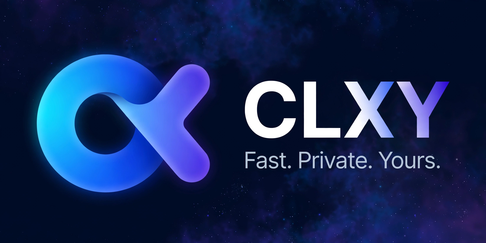

<div dir="rtl">

<p align="center" dir="ltr">
  <a href="README.md"></a>
</p>

<p align="center" dir="ltr">
  
</p>

<p align="center" dir="ltr">
  <a href="https://github.com/ClxybyCloner/ClxyPro/releases/latest"></a>
  <a href="https://github.com/ClxybyCloner/ClxyPro/releases"></a>
  
  <a href="https://github.com/ClxybyCloner/ClxyPro/releases"></a>
</p>

<h1 align="center">کلای‌پرو — هایپر و کوانتوم برای اندروید</h1>

<p align="center" dir="ltr">
  
</p>

این **کانال رسمی دانلود و به‌روزرسانی** اپلیکیشن اندروید کلای‌پرو است.
هر نسخه این‌جا منتشر می‌شود — و به‌روزرسانی درون‌برنامه‌ای دقیقاً همین ریپو را
چک می‌کند؛ پس اگر کلای‌پرو را داری، همیشه فقط یک لمس با جدیدترین نسخه فاصله داری.

<p align="center" dir="ltr">
  
</p>

## ⬇️ دانلود

**آخرین نسخه: 1.5.37** (۲۸ نوامبر ۲۰۲۶)

- 📦 [دانلود APK نسخهٔ ARM64](https://github.com/ClxybyCloner/ClxyPro/releases/download/v1.5.37/ClxyPro-1.5.37-arm64-v8a.apk)
- [مشاهدهٔ هش SHA-256](https://github.com/ClxybyCloner/ClxyPro/releases/download/v1.5.37/SHA256SUMS.txt)
- 🗂️ [مشاهده‌ی همه‌ی نسخه‌ها](https://github.com/ClxybyCloner/ClxyPro/releases)

سورس در همین ریپو است.

---

## ⚡ چرا CLXY

- 🌍 **اینترنت آزاد، همیشه در دسترس** — به سایت‌ها و سرویس‌های فیلترشده دسترسی پیدا کنید؛ تنها با یک لمس.
- 🚀 **سرعت و پایداری بالا** — مسیریابی چندلایه روی هسته‌ی Go با پشتیبانی از HTTP/3 (QUIC)؛ اتصالی سریع و پایدار، حتی روی اینترنت موبایل ضعیف.
- 🔒 **حریم خصوصی واقعی** — تونل VPN رمزنگاری‌شده برای کل دستگاه، با انتخاب جداگانه‌ی برنامه‌ها؛ شما مشخص می‌کنید کدام اپ‌ها از CLXY استفاده کنند.
- 👨‍👩‍👧 **یک اشتراک، چند دستگاه** — اتصال خود را از طریق وای‌فای یا هات‌اسپات با دستگاه‌های اطرافتان به اشتراک بگذارید (پروکسی SOCKS5 روی پورت `1081` و HTTP روی پورت `8080`).
- 👆 **راه‌اندازی در چند ثانیه** — بدون تنظیمات پیچیده؛ برنامه را باز کنید و متصل شوید.
- 🔄 **به‌روزرسانی با اجازه‌ی شما** — با انتشار هر نسخه‌ی جدید، برنامه اطلاع‌رسانی می‌کند و نصب تنها با تأیید شما انجام می‌شود.
- 🪶 **سبک و کم‌حجم** — حدود ۱۳ مگابایت؛ اجرای روان روی اندروید ۸ به بالا، حتی در گوشی‌های قدیمی.

---

## مسیریابی پیشرفته VPN (Advanced VPN Routing)

ترافیک CLXY از یک مسیر چندلایه عبور می‌کند — نه یک تک‌جهش VPN:

در این معماری، از ترکیب فناوری Xray و زیرساخت Mozilla VPN برای ایجاد یک مسیر ارتباطی چندلایه استفاده میشود. هدف، افزایش انعطافپذیری در مدیریت ترافیک، جداسازی مسیرهای ارتباطی و کنترل دقیقتر ترافیک ورودی و خروجی است.

ویژگیها:

* مسیریابی چندلایه: ایجاد زنجیره ارتباطی میان لایه ورودی و خروجی VPN.
* یکپارچهسازی Mozilla VPN: استفاده از زیرساخت WireGuard برای مدیریت مسیر خروجی.
* مسیریابی هوشمند: امکان هدایت ترافیک بر اساس سیاستهای تعریفشده.
* مدیریت تونل اختصاصی: کنترل مستقل مسیر ارتباطی و وضعیت تونل خروجی.
* محافظت از IP: جلوگیری از افشای آدرس IP اصلی در شرایط قطع تونل.
* مدیریت خطا و بازیابی: پیشبینی سازوکارهای کنترل اتصال و بازیابی مسیر ارتباطی.

ساختار ارتباطی:

VLESS → Xray Core → Linux Routing → Mozilla VPN → Internet

این ساختار با هدف ایجاد یک زیرساخت ارتباطی منعطف، قابل توسعه و قابل مدیریت طراحی شده است.

---

## 📱 نسخه اندروید — هایپر و کوانتوم

- **دو موتور در یک برنامه** — **هایپر CLXY**: لایه خروجی Mozilla VPN در مسیر مسیریابی چندلایه CLXY، روی HTTP/3 MASQUE با انتخاب خودکار خروجی (اول آلمان، بعد سریع‌ترین مسیر سالم) و لیست سرور زنده با پینگ. **کوانتوم CLXY**: مش مستقیم anycast با قفل سریال، لیست سرور با ۱۶ رله و پینگ واقعی TCP، و امکان پین کردن رله.
- **اتصال در حدود ۲ ثانیه** — توکن‌های سشن و OAuth از اولین ورود کش می‌شوند، پس اتصال دوباره نیازی به رفت‌وبرگشت‌های کند احراز هویت ندارد.
- **به‌روزرسانی درون‌برنامه‌ای** — دانلود و نصب نسخه‌های جدید داخل خود اپ؛ هیچ چیزی بدون تأیید شما نصب نمی‌شود.
- **ساخته‌شده برای اندروید** — کاشی تنظیمات سریع (Quick Settings) برای اتصال از هر جا، اسپلیت تانلینگ برای هر اپ، و پروکسی محلی SOCKS5 (`127.0.0.1:1080`) و HTTP (`127.0.0.1:8080`) برای بقیه‌ی اپ‌ها.
- **پنج زبان** — انگلیسی، فارسی، روسی، اسپانیایی و چینی.

---

## 🧠 معماری هسته‌ی CLXY

CLXY رابط کاربری نیتیو اندروید را با دو هسته‌ی شبکه‌ی Go ترکیب می‌کند، یکی برای هر موتور. هسته‌ها به‌صورت باینری نیتیو توسط اپ اجرا می‌شوند — سمت کاربر در مسیر مسیریابی چندلایه CLXY. رابط کاربری آن‌ها را از طریق کنترل پردازش مدیریت می‌کند و وضعیت اتصال را از خروجی آن‌ها می‌خواند، در حالی که هسته‌ها ترافیک شبکه را مدیریت می‌کنند.

در حالت VPN، سرویس `VpnService` اندروید یک اینترفیس مجازی TUN می‌سازد. یک پشته‌ی TCP/IP در فضای کاربر بسته‌ها را پردازش می‌کند و اتصال‌های TCP را به پروکسی SOCKS5 هسته می‌فرستد. ریزالور داخلی DNS نام دامنه‌ها را به آدرس‌های IP موقت نگاشت می‌کند تا قوانین مسیریابی همچنان بتوانند دامنه‌ها را تشخیص دهند. این قوانین انتخاب می‌کنند که از پروکسی استفاده شود، اتصال مستقیم برقرار شود یا اتصال مسدود شود. انتخاب اپ‌ها هم مشخص می‌کند کدام برنامه‌ها از VPN استفاده کنند.

هسته‌ها با HTTP/2 CONNECT روی TLS یا HTTP/3 CONNECT روی QUIC به گیت‌وی وصل می‌شوند. از آن‌جا ترافیک مسیر چندلایه CLXY را طی می‌کند: VLESS → Xray Core → Linux Routing → Mozilla VPN → Internet. آن‌ها همچنین یک پروکسی محلی SOCKS5 (`127.0.0.1:1080`) و HTTP (`127.0.0.1:8080`) برای بقیه‌ی اپ‌های دستگاه ارائه می‌دهند. مسیر VPN اندروید TCP و DNS را پوشش می‌دهد؛ بقیه‌ی ترافیک UDP تونل نمی‌شود.

---

## ⚡ نصب در ۶۰ ثانیه

1. **دانلود** — فایل APK را از لینک بالا دانلود کن.
2. **بازش کن** — اندروید ازت می‌خواهد برای مرورگرت *«نصب برنامه‌های ناشناس»* را مجاز کنی. یک بار مجاز کن.
3. **نصب را بزن.** تمام شد.

برای استفاده از CLXY به اشتراک نیاز داری.

---

## ✅ تأیید فایل دانلودشده

روی کامپیوتر، SHA-256 فایل APK را حساب کن:

<div dir="ltr">

```bash
sha256sum ClxyPro-1.5.37-arm64-v8a.apk
```

</div>

خروجی را با این هش موردانتظار مقایسه کن:

<div dir="ltr">

```text
acd4434b3ba446fff809b90402dda6ea07f0be94606c651672bca6da9b91a9ab  ClxyPro-1.5.37-arm64-v8a.apk
```

</div>

اگر یکی بودند، فایل دقیقاً همان چیزی است که ما منتشر کردیم.

---

## 🔄 به‌روزرسانی چطور کار می‌کند

CLXY به‌صورت دوره‌ای بخش **Releases** همین ریپو را برای نسخه‌ی جدیدتر چک می‌کند.
وقتی نسخه‌ی جدیدی پیدا شود، داخل اپ اعلان می‌گیری — بزن تا دانلود شود، بعد
خودت نصب را تأیید کن. اپ هرگز پشت سرت چیزی نصب نمی‌کند.

---

## 📋 مشخصات نسخه‌ی فعلی

| | |
|---|---|
| بسته | `com.clxypro.vpn` |
| نسخه / کد نسخه | `1.5.37` / `59` |
| معماری | `arm64-v8a` |
| حداقل اندروید | 8.0 (API 26) |
| حجم | حدود ۱۳٫۵ مگابایت |

---

## ❓ سؤالات پرتکرار

**سورس‌کد کجاست؟**
سورس‌کد در همین ریپو است.

**نسخه‌ی قدیمی‌تر می‌خواهم.**
نسخه‌های قدیمی در صفحه‌ی [Releases](https://github.com/ClxybyCloner/ClxyPro/releases) در دسترس می‌مانند.

**اشتراک‌گذاری اتصال امن است؟**
پروکسی‌های SOCKS5 (`1081`) و HTTP (`8080`) شبکه‌ی محلی عمداً بدون رمز هستند؛ پس **فقط روی شبکه‌ای که به آن اعتماد داری روشنشان کن** و وقتی کارت تمام شد خاموششان کن. هر کسی که به شبکه‌ی محلی‌ات وصل باشد می‌تواند از آن‌ها استفاده کند.

---

<p align="center" dir="ltr">
  
</p>

## 📜 شرایط استفاده

سورس‌کد در همین ریپو است. فایل‌های امضاشدهٔ رسمی و هش آن‌ها در این ریپو منتشر می‌شوند.

</div>
